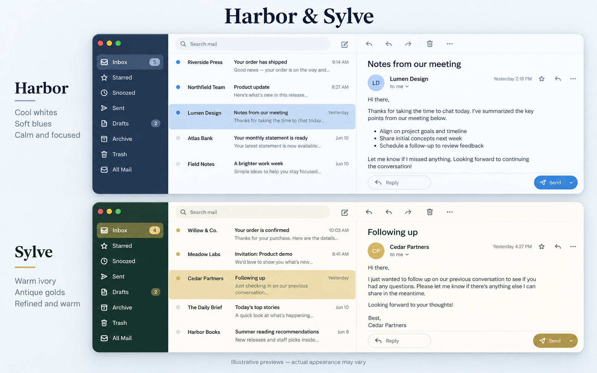

# Harbor & Sylve for Mailspring

Two community color variants of [Brume and Brume Ardoise](https://github.com/AlexandreAgrn/mailspring-theme-brume), originally created by Alexandre Augrain.

## Preview

**AI-generated illustrative mockup, not an actual Mailspring screenshot.** It shows the intended palettes; exact spacing, icons, content, and rendering may differ.

## Choose a palette

| Theme | Navigation | Surfaces | Accent |
| --- | --- | --- | --- |
| **Harbor** | Deep navy | Cool white | Soft blue |
| **Sylve** | Forest green | Warm ivory | Muted gold |

Both variants inherit Brume Ardoise's layout, typography, icons, and behavior, including this fork's readability adjustments: full-row unread shading, stronger selection, sidebar text spacing, Windows refresh icon styling, and rounded Send controls.

## Install

1. Download this repository using **Code → Download ZIP**, then extract it.
2. In Mailspring, choose **Edit → Install Theme** (or **Install Theme** from the app menu).
3. Select the entire **brume-harbor** or **brume-sylve** folder containing `package.json`. Do not select the `styles` subfolder.
4. Choose **Brume Harbor** or **Brume Sylve** under **Change Theme**.
5. Fully quit and reopen Mailspring if the theme or composer does not update.

Both variants can be installed side by side. Keep the extracted source folders outside Mailspring's packages directory when installing.

## Scope and compatibility

These are palette variants, not a rewrite of Mailspring. Email bodies may retain their own formatting. The original theme was designed primarily for macOS; these variants were tried in Mailspring on Windows, with positive user feedback. Other platforms and all display-scaling combinations have not been verified.

The original **brume** and **brume-ardoise** folders remain available in this fork. No upstream integration is required to use Harbor or Sylve.

## Credits and license

Based on **Brume / Brume Ardoise by Alexandre Augrain (AlexandreAgrn)**. Original source: https://github.com/AlexandreAgrn/mailspring-theme-brume

Community palette variants maintained in this fork by **technobulb**. Not an official upstream release.

MIT licensed. The original copyright notice and license are preserved in each theme folder.
